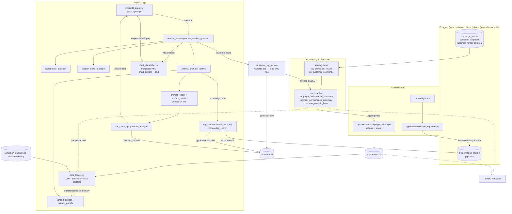

# Architecture — AI Marketing Analytics Assistant

> Written from a full read of the repository at commit `4a8a81f` ("dbt updates").
> Every claim cites a file and function. Anything marked **(inferred)** is a conclusion
> I drew but could not see directly in the code. Nothing was executed against a database
> or the OpenAI API while writing this.

---

## 0. Stack check (your description vs. what the code shows)

| You said | What the code shows |
|---|---|
| Streamlit front end | ✅ `streamlit_app.py`. There is **also** a terminal CLI (`main.py` → `app/ui/cli.py`) that shares the same back end. |
| NeonDB (Postgres) | ⚠️ The code is plain Postgres via SQLAlchemy + `psycopg` (v3). **Neon is never named anywhere.** The only hint is optional `DB_SSLMODE` support in `app/utils/database.py::get_database_engine`, which a hosted Postgres like Neon needs. **(inferred)** Neon is what the `DB_*` env vars point at in your deployed setup. README and `.idea/dataSources.xml` describe a **local** Postgres (`localhost:5432`, `dvdrental`). |
| dbt for transformations | ✅ `marketing_analytics_dbt/` (dbt Core, Postgres adapter 1.11 per `logs/dbt.log`; `sources.yml` also supports Snowflake). The app **never runs dbt**. It reads dbt output tables through static SQL files. |
| OpenAI API for AI features | ✅ `openai` SDK, **Responses API** (`client.responses.create`) for text, and `text-embedding-3-small` for RAG embeddings. |
| *(implied)* AI generates SQL | ⚠️ **Only for customer-level questions (Phase 3).** These go through guarded text-to-SQL against `customer_analytic_layer` (`app/services/customer_sql_service.py`, see §5). Every other question uses pre-aggregated mart tables loaded into pandas at start-up: Python picks rows and formats them as text, and the LLM only interprets that text. |
| *(not mentioned)* | Also present: **pgvector** for RAG, **matplotlib** for charts, **Tableau** workbook + CSV extracts, and a **CSV "demo mode"** that is the default data source. |

---

## 1. What the app does (plain language)

This is an "AI analyst" for marketing campaigns. A business user picks a campaign, such as the "Summer Retention Offer", and can press a button to get an AI-written executive summary of how it performed. They can also type questions like "Which segment performed best?", "Compare to CMP-2026-003", or "Chart revenue by segment". The app works out what kind of question it is and gathers the relevant numbers (campaign totals, per-segment results, or company-wide rankings). It hands those numbers to an OpenAI model with strict instructions to answer only from that data. For charting requests it also draws a bar chart. For "what does X mean?" questions, such as "What is Churn Watchlist?", it searches a small library of business definitions stored in Postgres and has the AI answer from those definitions. The numbers come from a dbt pipeline that turns raw campaign results into clean summary tables. A public demo can run entirely from CSV snapshots of those tables. The data is synthetic campaign data layered on the Postgres "dvdrental" sample database.

---

## 2. Project map

```
marketing_analytics/
├── streamlit_app.py            Streamlit UI (the web app / hosted demo entry point)
├── main.py                     CLI entry point (terminal version of the same app)
├── requirements.txt            Python deps (UTF-8, unpinned)
├── .env.example                Env var template (incomplete, see §6)
├── .devcontainer/              GitHub Codespaces config, auto-runs `streamlit run streamlit_app.py`
├── prompts/                    LLM prompt templates with {{placeholders}}
│   ├── analyst_guidelines.md     Ask Analyst prompt
│   ├── customer_sql.md           Customer text-to-SQL prompt (virtual table `cal`, JSON {sql, explanation})
│   └── executive_summary.md      Executive Summary prompt
├── app/
│   ├── config/
│   │   ├── settings.py           Loads .env; OPENAI_API_KEY + OPENAI_MODEL (hard fail if missing); SessionState dataclass
│   │   ├── paths.py              All filesystem paths; creates data/ and output/ on import
│   │   └── router.py             Keyword-based question classifier → RouteResult / VisualizationRequest
│   ├── ai/
│   │   ├── analyst_chat.py       ask_analyst(): builds context (if not supplied), fills prompt, calls LLM; response-format strings
│   │   ├── context_builder.py    DataFrame rows → plain-text "context" blocks for the LLM (campaign/segment/customer/comparison/insight)
│   │   ├── insight_signals.py    Pre-computed segment rankings ("derived signals") fed to the LLM
│   │   ├── campaign_id_validation.py  Raises if a requested campaign ID is not in summary data
│   │   ├── session_state_manager.py   Which campaign is "active"; resolves comparison pairs
│   │   ├── prompt_loader.py      Reads prompts/<name>.md
│   │   ├── prompt_builder.py     Replaces {{var}} placeholders; errors on unresolved ones
│   │   └── llm_client_api.py     The OpenAI text call (generate_analysis) + prompt-size guard
│   ├── services/
│   │   ├── analyst_service.py    process_analyst_question(): UI-agnostic orchestrator used by both UIs
│   │   ├── customer_sql_service.py  Customer questions: validate_sql(), run_customer_query() (guarded text-to-SQL)
│   │   └── rag_service.py        answer_with_rag(): knowledge-question path (pgvector search + OpenAI)
│   ├── visualization/
│   │   ├── chart_dispatcher.py   create_visualization(): picks which chart function to call
│   │   ├── campaign_charts.py    matplotlib bar charts by campaign (revenue, conversion rate)
│   │   ├── segment_charts.py     matplotlib bar charts by segment (revenue, test-vs-control conversion rate)
│   │   └── chart_builder.py      build_visualization_context(): the same chart data as text for the LLM
│   ├── utils/
│   │   ├── data_loader.py        Loads the 5 DataFrames at import (CSV or Postgres, via DATA_SOURCE)
│   │   ├── database.py           get_database_engine(): SQLAlchemy engine from DB_* env vars
│   │   ├── file_utils.py         load_sql_extracts() runs app/sql/*.sql → DataFrames; file_export() writes CSVs
│   │   ├── data_validation.py    pandas data-quality checks for the extract scripts
│   │   ├── embedding_service.py  create_embedding() (text-embedding-3-small)
│   │   ├── knowledge_loader.py   Reads marketing_analytics_dbt/knowledge/*.md
│   │   ├── knowledge_chunker.py  Splits markdown on #/## headings into chunks
│   │   ├── knowledge_ingestion.py  CLI: rebuild ai.knowledge_chunks (TRUNCATE + embed + INSERT)
│   │   ├── knowledge_search.py   search_knowledge_base(): category match or pgvector cosine search
│   │   └── dbt_utils.py          run_dbt_build(), unused, and runs `dbt build` when imported (see §9)
│   ├── extracts/
│   │   ├── campaign_extract.py   CLI: validate + export campaign CSVs (Tableau / demo data)
│   │   └── customer_extract.py   CLI: export customer_segmentation.csv
│   ├── sql/                      Static SQL run by load_sql_extracts (no user input)
│   │   ├── campaign_summary.sql          → {{analytics_schema}}.campaign_performance_summary
│   │   ├── campaign_segment_summary.sql  → {{analytics_schema}}.segment_performance_summary
│   │   ├── analytic_layer.sql            → {{analytics_schema}}.customer_analytic_layer
│   │   ├── campaign_goals.sql            → {{analytics_schema}}.campaign_goals (dbt seed)
│   │   ├── unique_campaigns_list.sql     → {{analytics_schema}}.campaign_performance_summary
│   │   ├── campaign_tableau_summary.sql  → raw campaign_results ⨝ customer_segment (Tableau only)
│   │   └── customer_segmentation.sql     → raw dvdrental tables; builds the segmentation (Tableau / customer_segment)
│   └── ui/
│       ├── cli.py                show_executive_summary(), run_cli_chat()
│       └── campaign_selector.py  Interactive terminal campaign picker
├── marketing_analytics_dbt/      dbt project (see §4)
│   ├── dbt_project.yml
│   ├── models/staging/           sources.yml, staging.yml, stg_*.sql (views)
│   ├── models/marts/             marts.yml + 4 mart models (tables)
│   ├── tests/                    8 singular data tests
│   └── knowledge/                RAG source documents (metrics, segments, data products, data quality)
├── data/demo/                    CSV snapshots, the default data source for the app
├── tableau/Summit Marketing.twb  Tableau workbook (points at local CSVs on the author's Windows machine)
├── tools/                        Ad-hoc tests/scripts (NOTE: tools/ is in .gitignore but these files are tracked)
├── assets/                       README screenshots
├── logs/dbt.log                  Stray dbt log from `dbt init` / `dbt debug`
├── .idea/                        PyCharm project files (tracked)
├── changelog.md                  Stops at v0.7.0
└── dvdrental_backup.sql          Empty (0 bytes)
```

---

## 3. End-to-end flow: a user asks a question in Streamlit

### 3a. App startup (on every Streamlit rerun, but cached)

1. `streamlit_app.py` imports `app.utils.data_loader`. Importing it **does real work**:
   - `app/config/settings.py` runs `load_dotenv()` and raises `RuntimeError` if `OPENAI_API_KEY` or `OPENAI_MODEL` is missing.
   - `app/config/paths.py` creates `data/` and `output/`.
   - `data_loader.py` reads `DATA_SOURCE` (default `"csv"`):
     - `csv` → `load_csv_data()` (wrapped in `@st.cache_data`) reads `data/demo/campaign_summary.csv`, `campaign_segment_summary.csv`, `campaign_goals.csv`, `campaign_analytic_layer.csv`, `unique_campaigns.csv`.
     - `postgres` → `load_postgres_data()` (`@st.cache_data(ttl=3600)`) → `file_utils.load_sql_extracts([...])` runs five `app/sql/*.sql` files, including goals from the `campaign_goals` seed. `{{analytics_schema}}` is replaced with `ANALYTICS_SCHEMA` (default `dbt_dev_analytics`).
   - The result is four module-level globals: `summary_df`, `segment_df`, `campaign_goals_df`, `unique_campaigns_df`. Customer-level data is not loaded into memory; customer questions query Neon directly (step 7d).
2. Importing `app/ai/llm_client_api.py`, `app/services/rag_service.py`, and `app/utils/embedding_service.py` each creates its own `OpenAI(...)` client.
3. *(Removed in Phase 2: `insight_signals.py` used to compute unused signals at import time.)*
4. `streamlit_app.py` initialises `st.session_state`: `analytics_session` (a `SessionState`), `executive_summary`, `messages` (visible chat), `analyst_history` (Q/A pairs sent to the LLM). It also builds `campaign_options`, sets the first campaign as active, and renders the sidebar selector (`handle_campaign_change` clears chat and summary when the campaign changes).

### 3b. Executive Summary button (`streamlit_app.py`, lines ~203–233)

`build_campaign_context(summary_df, campaign_goals_df, selected_campaign_id)` → `load_prompt("executive_summary")` → `build_prompt(template, {"campaign_metrics": context})` → `generate_analysis(final_prompt)` → stored in `st.session_state.executive_summary` → `st.markdown`. Only `ValueError` is caught.

### 3c. Ask Analyst chat

| # | Step | Where |
|---|---|---|
| 1 | User types into `st.chat_input`, and the message is appended to `st.session_state.messages` and echoed. | `streamlit_app.py` ~255–269 |
| 2 | `valid_campaign_ids` set is built from `unique_campaigns_df`. | `streamlit_app.py` ~271 |
| 3 | `process_analyst_question(question, session_state, default_campaign_id, valid_campaign_ids, conversation_history=analyst_history)` | `app/services/analyst_service.py` |
| 4 | **Routing.** `route_question(question)` lower-cases the text and pulls `CMP-####-###` IDs with a regex (`extract_campaign_ids`). It then applies ordered keyword rules: **comparison** (2+ IDs + compare term, or 1 ID + "compare to"/"vs") → **visualization** (chart/plot/graph + revenue or conversion rate; anything other than a bar chart raises `ValueError`) → **insight** (scope words like "overall", or insight words like "takeaways") → **knowledge/RAG** (`is_knowledge_question`) → **segment** → **customer** → **campaign evaluation** → **comparison** if any ID → default **campaign summary**. It returns `RouteResult(context_type, analysis_type, campaign_ids, visualization_request)`. | `app/config/router.py::route_question` |
| 5 | Loads `prompts/analyst_guidelines.md`. | `app/ai/prompt_loader.py::load_prompt` |
| 6 | Resolves the active campaign: the last explicit ID in the question becomes active if valid, otherwise the session's active campaign is used. | `app/ai/session_state_manager.py::resolve_campaign_id` |
| 7a | **Visualization route:** `create_visualization(...)` saves a PNG to `output/charts/<id>_segment_revenue.png` (etc.). `build_visualization_context(...)` renders the same numbers as text. `ask_analyst(...)` is then called once with a wrapper instruction and that context, and the result is returned immediately. | `app/visualization/chart_dispatcher.py`, `chart_builder.py`, `analyst_service.py` ~73–125 |
| 7b | **Comparison route:** `resolve_comparison_campaign_ids` pairs a single mentioned ID with the *previous* active campaign → `build_campaign_comparison_context` (validates IDs and concatenates per-campaign contexts). | `session_state_manager.py`, `context_builder.py` |
| 7c | **Insight route:** `build_insight_context(...)`. With a scope word and no ID it is portfolio-wide (sums across campaigns + derived signals across all campaign×segment rows). Otherwise it covers a single campaign (overall + per-segment + derived signals). | `context_builder.py::build_insight_context`, `insight_signals.py` |
| 8 | `ask_analyst(campaign_id, question, prompt_template, conversation_history, context)` **re-routes the question again**. If no context was passed it builds one: `knowledge` → **returns `answer_with_rag(question)` immediately** (step 8R); `campaign` → `build_campaign_context`/comparison; `segment` → `build_segment_context`; `insight` → `build_insight_context`. A `customer_campaign` route always arrives with a context from step 7d; without one it raises `ValueError`. | `app/ai/analyst_chat.py::ask_analyst` |
| 9 | **Prompt assembly.** `build_prompt` fills `{{response_format_instructions}}` (`STANDARD_RESPONSE_FORMAT`, `INSIGHT_RESPONSE_FORMAT`, or `DERIVED_SIGNAL_RESPONSE_FORMAT`, picked by `_get_response_format_instructions`), `{{campaign_context}}`, `{{conversation_history}}` (last 5 Q/A pairs via `_format_conversation_history`), and `{{question}}`. The question may have extra ranking instructions appended by `_build_question_with_instructions` / `_get_derived_signal_metric_instruction`. | `analyst_chat.py`, `app/ai/prompt_builder.py::build_prompt` |
| 10 | **OpenAI call.** `generate_analysis(prompt)` rejects empty or >400,000-character prompts. It calls `client.responses.create(model=MODEL_NAME, input=prompt)`, returns `response.output_text.strip()`, and maps context-length errors to `ValueError` and other API errors to `RuntimeError`. | `app/ai/llm_client_api.py::generate_analysis` |
| 8R | **RAG path:** `search_knowledge_base(question, limit=3)` embeds the question. If any `ai.knowledge_chunks.category` string appears in the question it returns **all** chunks of that category (similarity hard-coded to 1.0). Otherwise it runs a pgvector cosine search (`embedding <=> CAST(:embedding AS vector)`). Below 0.35 similarity the app returns a canned "not enough information" answer. Otherwise an inline prompt goes to `client.responses.create(model="gpt-5.5", ...)`. | `app/services/rag_service.py::answer_with_rag`, `app/utils/knowledge_search.py`, `embedding_service.py` |
| 7d | **Customer route (text-to-SQL):** `route_question` sends customer-grain questions (country, tier, recency, favourite category, "how many / which / top N customers") to `customer_campaign`. A short follow-up ("What about Canada?") after a customer question stays on this route. `_answer_customer_question` requires `DATA_SOURCE=postgres`. Scope is the campaign IDs in the question (validated), else the active campaign. `run_customer_query` fills `prompts/customer_sql.md` and calls `generate_json` (structured `{sql, explanation}`). `validate_sql` checks it and re-generates the SQL. `execute_customer_query` runs it as the read-only role, scoped to those campaigns with a row limit; one retry on a DB error. `build_customer_query_context` turns ≤50 result rows into a markdown table, which goes to `ask_analyst(context=...)`. | `app/services/analyst_service.py`, `app/services/customer_sql_service.py` |
| 11 | Returns `AnalystResult(answer, campaign_id, chart_path, sql)`. The UI shows `sql` in a "SQL used" expander. | `analyst_service.py` |
| 12 | Streamlit appends `{question, answer, timestamp}` to `analyst_history`, appends the assistant message (with `chart_path`) to `messages`, renders `st.markdown(answer)`, and calls `st.image(chart_path)` if a chart exists. A `ValueError` is shown as "Analyst: <error>". | `streamlit_app.py` ~276–318 |

**SQL at question time:** for most questions, none against the analytics tables, since those DataFrames are already in memory. The exceptions are the RAG lookup in `knowledge_search.py` (bound parameters) and **customer questions**, which run one model-written, validated SELECT as the read-only role (step 7d).

---

## 4. Data layer (dbt)

### Sources (`models/staging/sources.yml`)
Source `dvdrental`, with schema `public` on Postgres and `RAW` on Snowflake. Tables: `customer`, `rental`, `payment`, `campaign_results`, `customer_segment`, `address` (`address` is declared but unused).

- `campaign_results`: synthetic, one row per customer × campaign, with raw column names `treatment_grp`, `contacted_flg`, `response_flg`, `cnvrsn_flg`, `cmpgn_rvn`, costs, dates, `channel`, `updated_at`. **(inferred)** Loaded by a script that is not in the repo (`tools/check_schema.py` mentions a missing `generate_synthetic_data.py`).
- `customer_segment`: **(inferred)** a table you created from the output of `app/sql/customer_segmentation.sql`. `stg_customer_segment` reads `market_segment`, `primary_segment`, and the `is_*` flags, which are exactly the columns that query produces. No code in the repo writes this table.

### Staging (views, `+schema: staging`)
| Model | Reads | Notes |
|---|---|---|
| `stg_campaign_results` | `campaign_results` | Renames raw columns: `treatment_grp→treatment_group`, `cnvrsn_flg→conversion_flag`, `cmpgn_rvn→campaign_revenue`, etc. |
| `stg_customer_segment` | `customer_segment` | `market_segment AS customer_segment`. This 4-value label (Champion / Win-Back / Growth / Churn Watchlist) is what the app calls a "segment". |
| `stg_customer`, `stg_rental`, `stg_payment` | dvdrental tables | Only used by `customer_summary`. |

### Marts (tables, `+schema: analytics`)
| Model | Grain | Built from | Used by app? |
|---|---|---|---|
| `campaign_performance_summary` | 1 row / campaign | `stg_campaign_results` | ✅ `app/sql/campaign_summary.sql` → `summary_df` |
| `segment_performance_summary` | 1 row / campaign × segment | `stg_campaign_results` (TEST and CONTROL aggregated separately, then joined; lift, incremental revenue, ROI) | ✅ `app/sql/campaign_segment_summary.sql` → `segment_df` |
| `customer_analytic_layer` | 1 row / customer × campaign (incremental on `updated_at`) | `stg_campaign_results` ⨝ `stg_customer_segment` | ✅ `app/sql/analytic_layer.sql` → `customer_df` |
| `customer_summary` | 1 row / customer | `stg_customer`, `stg_rental`, `stg_payment` | ❌ unused |

Lineage:
```
campaign_results ─► stg_campaign_results ─┬─► campaign_performance_summary
                                           ├─► segment_performance_summary
customer_segment ─► stg_customer_segment ─┴─► customer_analytic_layer
customer/rental/payment ─► stg_* ─► customer_summary (unused)
```

Tests: generic `not_null`/`unique`/`relationships` in `staging.yml` and `marts.yml`, plus 8 singular tests in `tests/` (grain uniqueness, rates in [0,1], conversions ≤ audience, non-negative revenue/cost, TEST/CONTROL cost rules).

### What the app actually queries
- **Default (CSV mode):** no database at all for analytics. It reads `data/demo/*.csv`, which are snapshots exported by `app/extracts/campaign_extract.py`.
- **Postgres mode (Neon):** `dbt_dev_analytics.campaign_performance_summary` (also the campaign list), `.segment_performance_summary`, `.customer_analytic_layer`, and `.campaign_goals` (seed). The schema comes from `ANALYTICS_SCHEMA`.
- **Always (RAG):** `ai.knowledge_chunks` (pgvector), written by `app/utils/knowledge_ingestion.py`.
- **Goals:** the dbt seed `marketing_analytics_dbt/seeds/campaign_goals.csv` → `dbt_dev_analytics.campaign_goals` in postgres mode. CSV mode uses the exported copy `data/demo/campaign_goals.csv`.

> ✅ Schema: `dbt_project.yml` sets `+schema: staging/analytics` (models and seeds). With dbt's default `generate_schema_name` and target schema `dbt_dev`, everything the app reads lands in `dbt_dev_analytics`, locally and in Neon (`--target neon`, see `profiles.example.yml`). The demo CSVs use the same column names as the marts (checked by `tests/test_context_builders.py`).

---

## 5. AI layer

### Models
| Use | Model | Where |
|---|---|---|
| Executive summary + Ask Analyst | `OPENAI_MODEL` env var (required, no default) | `llm_client_api.py::generate_analysis` |
| RAG answers | **hard-coded `"gpt-5.5"`** (ignores `OPENAI_MODEL`) | `rag_service.py::answer_with_rag` |
| Embeddings (ingest + query) | `text-embedding-3-small` (1536 dims) | `embedding_service.py::create_embedding` |

All text calls use the **Responses API** with a single string `input=`. There is **no separate system message**, no temperature or max-tokens, and no tools or structured outputs. Everything (role, rules, data, history, question) is one user-turn string.

### Prompts
1. **`prompts/executive_summary.md`** (placeholder `{{campaign_metrics}}`). Role: Senior Marketing Analytics Consultant. Rules: no invented metrics, no calculations, sections for Key Strengths / Key Weaknesses / Business Risks / Recommended Next Actions (3–5 numbered), plus a full worked example using real Summer Retention Offer numbers.
2. **`prompts/analyst_guidelines.md`** (placeholders `{{response_format_instructions}}`, `{{campaign_context}}`, `{{conversation_history}}`, `{{question}}`). Covers grounding rules, comparing campaigns, insight discovery, using derived signals ("verified rankings, don't recalculate"), and visualization interpretation.
3. **Response-format inserts** in `app/ai/analyst_chat.py`: `STANDARD_RESPONSE_FORMAT` (conclusion sentence, bullets, no emphasis), `INSIGHT_RESPONSE_FORMAT` (five required `##` sections), `DERIVED_SIGNAL_RESPONSE_FORMAT` (for portfolio "overall" questions), and `DERIVED_SIGNAL_PRIORITY_INSTRUCTIONS` plus a per-metric instruction appended to the question for "which segment had the highest X" questions.
4. **Visualization wrapper instruction**, inline in `app/services/analyst_service.py` (~96–108).
5. **RAG prompt**, inline f-string in `app/services/rag_service.py` (Markdown rules, no LaTeX, use only the context).
6. **`prompts/customer_sql.md`** (placeholders `{{campaign_scope}}`, `{{conversation_history}}`, `{{previous_error}}`, `{{question}}`): describes the virtual table `cal` (columns, allowed values, metric definitions) and rules (one SELECT, only `cal`, ≤50 rows, ORDER BY). Returns structured JSON `{sql, explanation}` via `llm_client_api.generate_json`.

### How data/schema reaches the model
For prepared-context questions there is no schema in the prompt and the model never sees table or column names. (The customer SQL prompt is the exception: it describes the one virtual table `cal`.) `app/ai/context_builder.py` turns specific DataFrame rows into labelled, pre-formatted text ("Campaign Revenue: $10,282.98", "Conversion Rate: 18.0%"). `app/ai/insight_signals.py` pre-computes argmax/argmin rankings so the model doesn't have to do arithmetic. Conversation memory is the last 5 Q/A pairs as plain text.

### Parsing and validation
- **Before the call:** `build_prompt` raises on unresolved `{{vars}}`. `_validate_prompt_size` caps prompts at 400k characters. Campaign IDs are validated (`validate_campaign_ids` for comparisons, plus the "not found" checks in each context builder).
- **Customer SQL guardrails (layered):**
  1. `validate_sql`, using sqlglot: exactly one query statement. No DDL/DML/COPY/SET/SELECT INTO/FOR UPDATE anywhere, including inside CTEs. Only `cal` or the query's own CTEs, with no schema-qualified tables. No `pg_*`/`dblink`/`lo_*`/`current_setting`/`set_config` functions.
  2. The SQL is re-generated from the parse tree with comments removed, so the validated text is what runs.
  3. The `WITH cal AS (... WHERE campaign_id = ANY(:campaign_ids))` wrapper enforces campaign scope, plus `LIMIT 51`.
  4. Read-only Neon role `app_readonly` with SELECT on `customer_analytic_layer` only, `default_transaction_read_only`, and `statement_timeout = 5s`.
  5. `SET TRANSACTION READ ONLY` + `SET LOCAL statement_timeout` per query.
  6. Only ≤50 result rows reach the interpretation prompt.

  Tested in `tests/test_customer_sql_validation.py` and `tests/test_customer_sql_postgres.py`.
- **After the call:** only "non-empty text" (`generate_analysis`). Output is free-form Markdown rendered directly with `st.markdown`. Nothing checks that the model followed the format or quoted correct numbers. The RAG path has no validation or error handling at all.

---

## 6. Configuration and secrets

| Variable | Required? | Read in | Purpose |
|---|---|---|---|
| `OPENAI_API_KEY` | **Yes** (import-time `RuntimeError`) | `app/config/settings.py` | All OpenAI calls |
| `OPENAI_MODEL` | **Yes** (import-time `RuntimeError`); **missing from `.env.example`** | `settings.py` → `llm_client_api.py` | Model for summary and analyst |
| `DATA_SOURCE` | No (default `csv`) | `app/utils/data_loader.py` | `csv` or `postgres` (target: `postgres` on Neon) |
| `ANALYTICS_SCHEMA` | No (default `dbt_dev_analytics`) | `app/utils/database.py::get_analytics_schema` | Schema substituted for `{{analytics_schema}}` in `app/sql/*.sql`. Validated as a plain identifier. |
| `DB_HOST`, `DB_PORT`, `DB_NAME`, `DB_USER`, `DB_PASSWORD` | For postgres mode, **RAG**, ingestion, extracts | `app/utils/database.py::get_database_engine` | Built with `URL.create` (password escaped). One cached engine per process with `pool_pre_ping`. |
| `DB_SSLMODE` | `require` for Neon | `database.py` | Passed as `connect_args["sslmode"]` |
| `DB_READONLY_USER`, `DB_READONLY_PASSWORD` | For customer questions (no fallback) | `database.py::get_readonly_engine` | Restricted role for model-written SQL. Create it in Neon with the SQL below. dbt re-grants SELECT on `customer_analytic_layer` on every `--target neon` build (config in the model). |
| *(dbt)* `~/.dbt/profiles.yml`, profile `marketing_analytics_dbt` | For dbt only | `dbt_project.yml` | Not in repo. The log shows a Postgres target with schema `public` at `dbt debug` time. |

Files: `.env` at the project root, loaded by `settings.py` (CWD-based `load_dotenv()`) and again by `database.py` (explicit path). Streamlit `st.secrets` support is **commented out** in `settings.py`. **(inferred)** On Streamlit Community Cloud this still works because top-level secrets are exported as environment variables.

No real secrets are committed (`.env` is git-ignored, and `.env.example` holds placeholders).

Read-only role for customer text-to-SQL (run once in the Neon SQL editor, then `dbt build --target neon`):
```sql
CREATE ROLE app_readonly LOGIN PASSWORD '<strong password>';
GRANT USAGE ON SCHEMA dbt_dev_analytics TO app_readonly;
GRANT SELECT ON dbt_dev_analytics.customer_analytic_layer TO app_readonly;
ALTER ROLE app_readonly SET default_transaction_read_only = on;
ALTER ROLE app_readonly SET statement_timeout = '5s';
```

---

## 7. External dependencies

From `requirements.txt` (unpinned):

| Library | Used for |
|---|---|
| `streamlit` | Web UI, plus `st.cache_data` in `data_loader.py` (imported even by the CLI) |
| `openai` | Responses API + embeddings |
| `pandas` | All in-memory analytics, CSV I/O, `pd.read_sql` |
| `SQLAlchemy` | DB engine, `text()` queries with bound params |
| `psycopg[binary]` | Postgres driver (psycopg **3**; README says psycopg2) |
| `python-dotenv` | `.env` loading |
| `matplotlib` | PNG bar charts |
| `numpy` | Bar offsets in `segment_charts.py` |
| `openpyxl`, `PyYAML`, `requests` | **Not imported anywhere** in the repo |

Not in requirements but needed: `dbt-postgres` (for dbt), `pytest` (for `tools/` tests), and the **pgvector Postgres extension** (server-side; no Python package needed because embeddings are cast from strings).

---

## 8. Architecture diagram



---

## 9. Gaps, bugs, risks, and inconsistencies (listed only, nothing fixed)

Severity is my judgement: 🔴 likely user-visible breakage · 🟠 wrong or wasteful behaviour · 🟡 hygiene / maintainability.

### Bugs found by reading (not executed)
1. ✅ **Fixed:** Charts came with the wrong answer and cost two LLM calls. The visualization branch of `analyst_service.process_analyst_question` fell through to a second `ask_analyst(context=None)` call that overwrote the chart interpretation. It now returns right after the chart-interpretation call.
2. ✅ **Fixed (Phase 3):** Customer-level questions crashed (wrong column names, ~10k rows in the prompt). `build_customer_context` is removed. Customer questions now use guarded text-to-SQL against `customer_analytic_layer`, and only ≤50 aggregated rows reach the model.
3. ✅ **Fixed (Phase 2):** Postgres mode was out of sync with the code. The code now uses the dbt mart names (`incremental_revenue`, `segment_revenue_per_conversion`). `data/demo/campaign_segment_summary.csv` headers were renamed to match, and `insight_signals.py` no longer computes signals at import.
4. ✅ **Fixed (Phase 2):** dbt schema vs. app SQL. `app/sql/*.sql` uses `{{analytics_schema}}` (default `dbt_dev_analytics`) instead of the stale `dbt_dev`.
5. 🟠 **`app/utils/dbt_utils.py` calls `run_dbt_build()` at import.** Importing it shells out to `dbt build`. Nothing imports it today, so this is a trap waiting to fire.
6. 🟠 **CLI has no conversation memory.** `cli.run_cli_chat` never appends to `conversation_history`.
7. ✅ **Fixed:** Charts disappeared after a rerun. The history loop in `streamlit_app.py` now re-displays each message's `chart_path`.
8. ✅ **Fixed:** Chart files were shared. `chart_dispatcher.create_visualization` now adds a random suffix to each PNG filename, so concurrent users no longer overwrite each other's charts.
9. ✅ **Fixed (Phase 2):** `build_segment_context` now filters goals with its `goals_df` argument.
10. 🟡 `knowledge_search.search_knowledge_base`: the duplicate embedding call is fixed (Phase 2). A category match still ignores `limit` and fakes `similarity = 1.0`.
11. 🟠 `app/sql/customer_segmentation.sql` contains **two statements** (a stray `SELECT * FROM customer_segment cs` at the end). How `pd.read_sql` handles that depends on the driver.
12. 🟠 `customer_extract.export_customer` prints validation results but **exports anyway**. Both extract scripts write into `data/demo/`, overwriting the hosted demo's data.
13. 🟡 Broken tests: `tools/analyst_response_format_test.py` calls `_get_response_format_instructions` with 1 argument (it needs 2). `tools/test_insight_signals.py` imports the non-existent `app.tests.insight_signals_campaign`. Every test import needs `OPENAI_API_KEY`/`OPENAI_MODEL` set because `settings.py` raises at import. `tools/` is git-ignored even though these files are tracked.
14. 🟡 `staging.yml`: `stg_rental` is indented **inside** `stg_customer`'s `columns:` list, so its tests are not attached to the model.

### Error handling / robustness
15. 🔴 Streamlit catches only `ValueError`. `RuntimeError` (OpenAI failures from `generate_analysis`), `KeyError`, DB/connection errors, and any exception from `answer_with_rag` (no try/except at all) surface as raw tracebacks.
16. 🟠 **RAG needs a live database even in "CSV demo" mode.** Knowledge questions always hit `ai.knowledge_chunks`. **(inferred)** That is why the hosted demo has DB credentials, likely pointing at Neon.
17. 🟠 A new engine is created per call (`load_sql_extracts`, `search_knowledge_base`). No pooling, retries, or timeouts beyond OpenAI SDK defaults. Postgres-mode loads are not cached.
18. 🟡 The DB password is interpolated into the URL **without URL-encoding**, so special characters break the connection.
19. 🟡 Heavy import-time side effects: env validation, directory creation, data loading, 3 OpenAI clients, and the unused signal computation.

### Hard-coded values
20. RAG model `"gpt-5.5"`, embedding model, `limit=3`, `min_similarity=0.35`, `MAX_PROMPT_CHARACTERS=400_000`, last-5 history, chart colours/paths, campaign ID regex `CMP-\d+(-\d+)*`, segment names in validators, example campaign IDs in the sidebar. The executive-summary prompt embeds real numbers from one campaign as its example, which can anchor outputs.

### Security
21. **SQL injection:** static app SQL and RAG use bound parameters. **Model-written SQL (customer route)** is the one place generated SQL runs, behind the layered guardrails in §5. Treat changes to `customer_sql_service.py`, the read-only role or its grants as security-sensitive. `tools/check_schema.py` uses f-string table names, but they come from a hard-coded dict.
22. **Prompt injection:** user text, conversation history, and RAG chunks are concatenated into one prompt with no system/user separation. For prepared-context answers the impact is limited because the model has no tools. On the customer route the model writes SQL, so a prompt-injected question can only produce a validated, read-only SELECT on campaign-scoped `customer_analytic_layer` rows.
23. `.devcontainer` runs Streamlit with `--server.enableCORS false --server.enableXsrfProtection false` (fine for Codespaces, not for production).

### Duplication / dead code / inconsistency
24. Scope terms are defined three times (`router.py`, `analyst_chat.SCOPE_TERMS`, `analyst_service.scope_terms`). The question is routed twice (service + `ask_analyst`). Context is built in two places. The executive-summary flow is duplicated between `streamlit_app.py` and `cli.py`. The campaign-metadata block is copy-pasted across 3 context builders. The four chart functions are near-duplicates, and `chart_builder`/`chart_dispatcher` repeat the same if-chain.
25. Unused: `customer_summary` mart; `validate_customer_data` and `validate_segmentation_data`; `cosine_similarity`; `AnalystResult.chart_title`; `SessionState.active_segment`; unused imports in `streamlit_app.py`/`cli.py`; `pie/line/scatter` detection that always errors; commented-out "conversions" metric; `openpyxl`/`PyYAML`/`requests`; `data/demo/customer_extract.csv` (no producer in repo); empty `dvdrental_backup.sql`; `logs/dbt.log`; boilerplate `marketing_analytics_dbt/README.md`.
26. README drift: says `python -m app.main` (the entry is the root `main.py`), lists `campaign_performance_summary.sql` (the file is `campaign_summary.sql`), mentions `app/generation/` (doesn't exist), says psycopg2 (code uses psycopg 3), and its `ai.knowledge_chunks` DDL lacks the `category` column the code writes and reads. `changelog.md` stops at v0.7.0.
27. Data / docs inconsistencies: `metrics.md` says absolute lift / conversion rate are "available in segment_performance_summary" only, but the campaign mart also has them. `segments.md` describes 4 market segments, while `customer_segmentation.sql` defines 10 `primary_segment` values. The validator's `expected_segment` comments out "Category Expansion", which the SQL still assigns, so it would report mismatches.
28. Router fragility: substring matching (`"vs"` inside other words, `"better"` triggers comparison terms, broad `"what are"`/`"tell me"` RAG triggers). The order of rules determines meaning, and only 2 of the routing tests are enabled.
29. Prompt contradictions: `executive_summary.md` says "do not use headings" but specifies `#`/`##` sections. `STANDARD_RESPONSE_FORMAT` forbids emphasis while the insight format requires `##` headings. Typo "whe" in `DERIVED_SIGNAL_RESPONSE_FORMAT`.
30. ✅ **Fixed (Phase 2):** `requirements.txt` is now UTF-8. Still fully unpinned, which is a reproducibility risk for the hosted app.
31. In the Streamlit sidebar, typing a different campaign ID in chat changes the "Active Campaign" badge but not the selectbox value, so the two can disagree.

---

## 10. Questions I'd want answered before making changes

1. **Neon:** Is the deployed app (Streamlit Cloud?) pointing `DB_*` at Neon with `DB_SSLMODE=require`? Is the hosted demo `DATA_SOURCE=csv` with Neon used only for RAG, or is it `postgres`?
2. **dbt target:** What `schema` does your `profiles.yml` target use, and where do the marts actually land (`dbt_dev` vs `dbt_dev_analytics`)? Should the app read the marts or keep using CSV snapshots?
3. **Column names:** Which naming is canonical, the dbt mart names (`incremental_revenue`, `segment_revenue_per_conversion`) or the demo CSV names (`incremental_rev`, `segment_rpr`)? Can I regenerate the demo CSVs?
4. **`customer_segment` table and `campaign_results`:** How are these created and loaded (scripts outside the repo)? Should that become a dbt model/seed?
5. **Campaign goals:** Should `campaign_goals.csv` become a dbt seed or table, or stay a CSV?
6. **New features:** Do you want text-to-SQL (the LLM generating queries against Neon), or keep the current "pre-computed context" design? This is the biggest architectural fork.
7. **Model choice:** What is `OPENAI_MODEL` set to, and should RAG use it instead of the hard-coded `gpt-5.5`?
8. **Is the CLI still a supported interface,** or is Streamlit the only target going forward?
9. **Tests:** May I make `tools/` a real pytest suite (un-ignore it, fix the two broken tests, avoid needing a real API key at import)?
10. **Should I fix the 🔴 bugs (chart answer overwrite, customer KeyError) before new features,** or leave them alone?

---

## 11. Where changes would go

**(a) A new type of question the AI can answer**
- `app/config/router.py::route_question`: add keyword tuple(s) and a new `RouteResult(context_type=..., analysis_type=...)` branch, placed carefully in the rule order.
- `app/ai/context_builder.py`: new `build_<x>_context(...)` that turns DataFrame rows into labelled text (and, if it needs rankings, a helper in `app/ai/insight_signals.py`).
- `app/ai/analyst_chat.py::ask_analyst`: new `elif route.context_type == "<x>"` branch, plus `_get_response_format_instructions` if it needs its own format.
- `app/services/analyst_service.py::process_analyst_question`: only if the context must be pre-built from session state (as comparisons and insights are).
- `prompts/analyst_guidelines.md`: a guidance section for the new question type.
- If it's a definitions-style question instead: add a `##` section to `marketing_analytics_dbt/knowledge/*.md` and re-run `python -m app.utils.knowledge_ingestion`. No code change needed.
- Tests in `tools/question_route_test.py`.

**(b) A new dbt model feeding the app**
- `marketing_analytics_dbt/models/marts/<new_model>.sql` + entry in `models/marts/marts.yml` (+ singular tests in `tests/`). Staging in `models/staging/` (+ `sources.yml` if it needs a new raw table).
- `app/sql/<new_extract>.sql` (`select * from <schema>.<new_model>`).
- `app/utils/data_loader.py`: add to both `load_postgres_data()` and `load_csv_data()` and to the exported globals.
- `app/extracts/campaign_extract.py::export_campaign_results`: export the matching `data/demo/<new>.csv` so CSV mode works.
- Then consume it in `context_builder.py` / `chart_builder.py`, and document it in `knowledge/data_products.md`.

**(c) A new page or chart in the Streamlit UI**
- New chart reachable via chat: a function in `app/visualization/campaign_charts.py` or `segment_charts.py`, a branch in `chart_dispatcher.create_visualization`, a matching text branch in `chart_builder.build_visualization_context`, and metric/chart-type keywords plus validation in `router.route_question` (the pie/line/scatter stubs and the `ValueError` gate are there).
- New page: today everything is one script, `streamlit_app.py`. Adding a page means either `st.navigation`/a `pages/` directory (moving shared session-state setup into a helper) or a `st.tabs` section in `streamlit_app.py`. Data comes from the `app/utils/data_loader.py` globals. Native charts (`st.bar_chart` / `st.altair_chart`) would avoid the matplotlib→PNG→`output/` round trip.
